<p align="center">
  <picture>
    <source media="(prefers-color-scheme: dark)" srcset="keepsake/icons/styles/pantry/dark/icon128.png">
    
  </picture>
</p>

# Patchwork

**Save products, places, recipes, workouts, videos, articles, films and books from anywhere. Sorted for you, kept on your device, no account.**

Patchwork runs in Chrome (and other Chromium browsers), in Safari on the Mac, and as an app for iPhone and iPad. Save from any site with one click. Shopping sorts itself into collections; everything else goes to its own Lifestyle view. Everything stays on your own device.

Made by [Rare Creatures LLC](https://rarecreatures.app). Questions or feedback: [hello@rarecreatures.app](mailto:hello@rarecreatures.app).

## Screenshots

Every screenshot uses the built-in sample data. They follow your GitHub theme: switch GitHub to dark mode to see the dark versions.

**Chrome: Home and Library**

<picture>
  <source media="(prefers-color-scheme: dark)" srcset="docs/screenshots/chrome-home-dark.png">
  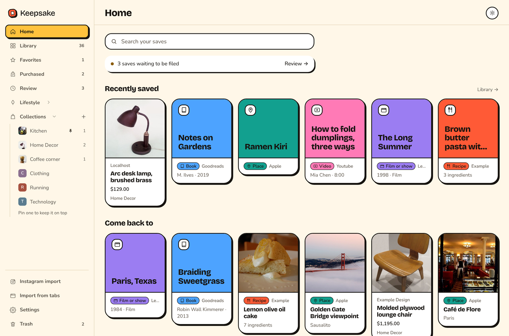
</picture>

<picture>
  <source media="(prefers-color-scheme: dark)" srcset="docs/screenshots/chrome-library-dark.jpg">
  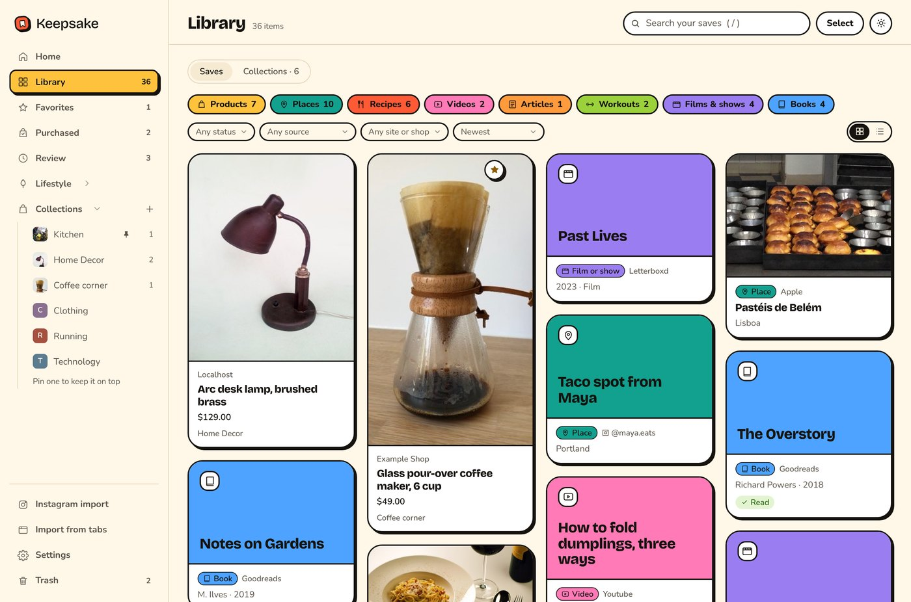
</picture>

**iPhone: Home, Library, cooking mode and Appearance**

<p>
  <picture>
    <source media="(prefers-color-scheme: dark)" srcset="docs/screenshots/iphone-home-dark.png">
    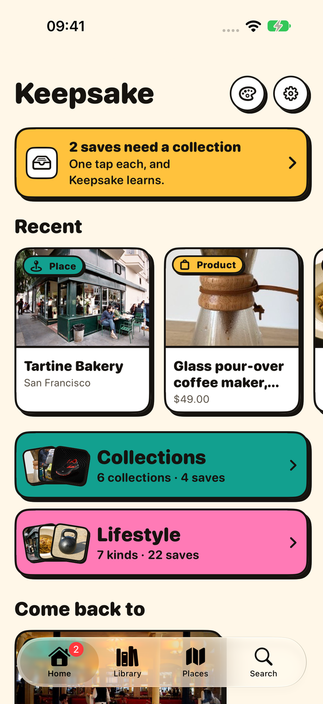
  </picture>
  <picture>
    <source media="(prefers-color-scheme: dark)" srcset="docs/screenshots/iphone-library-dark.png">
    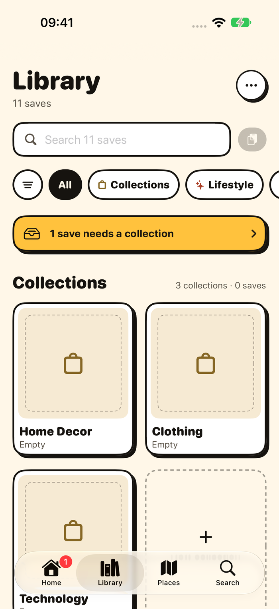
  </picture>
  <picture>
    <source media="(prefers-color-scheme: dark)" srcset="docs/screenshots/iphone-cooking-dark.png">
    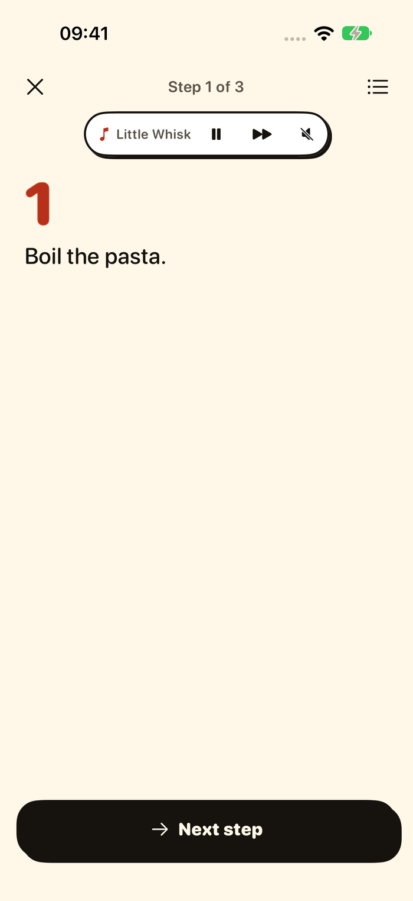
  </picture>
  <picture>
    <source media="(prefers-color-scheme: dark)" srcset="docs/screenshots/iphone-appearance-dark.png">
    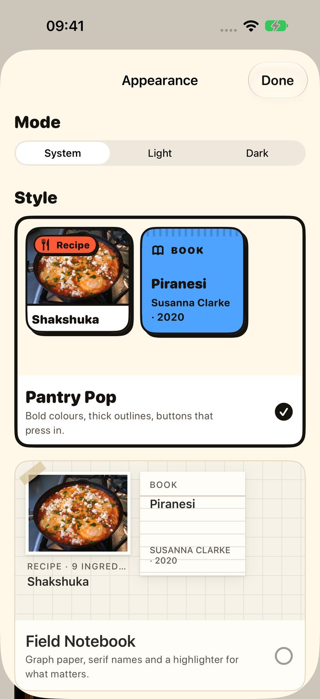
  </picture>
</p>

**Safari on the Mac**

<picture>
  <source media="(prefers-color-scheme: dark)" srcset="docs/screenshots/mac-dark.png">
  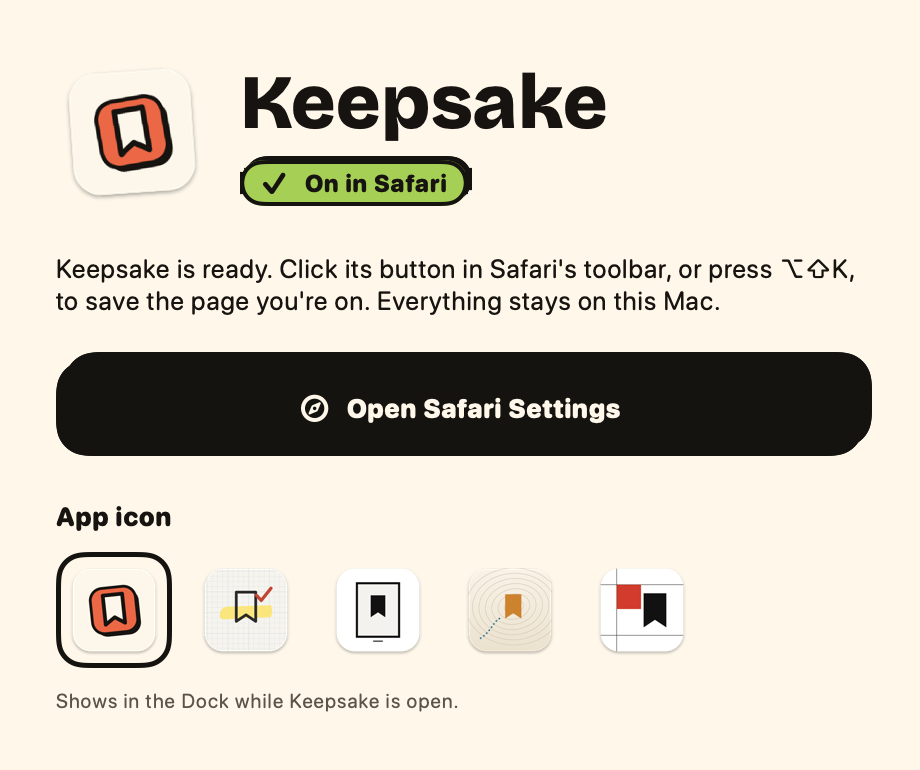
</picture>

<details>
<summary>All screenshots, light and dark side by side</summary>

| Light | Dark |
| --- | --- |
|  | 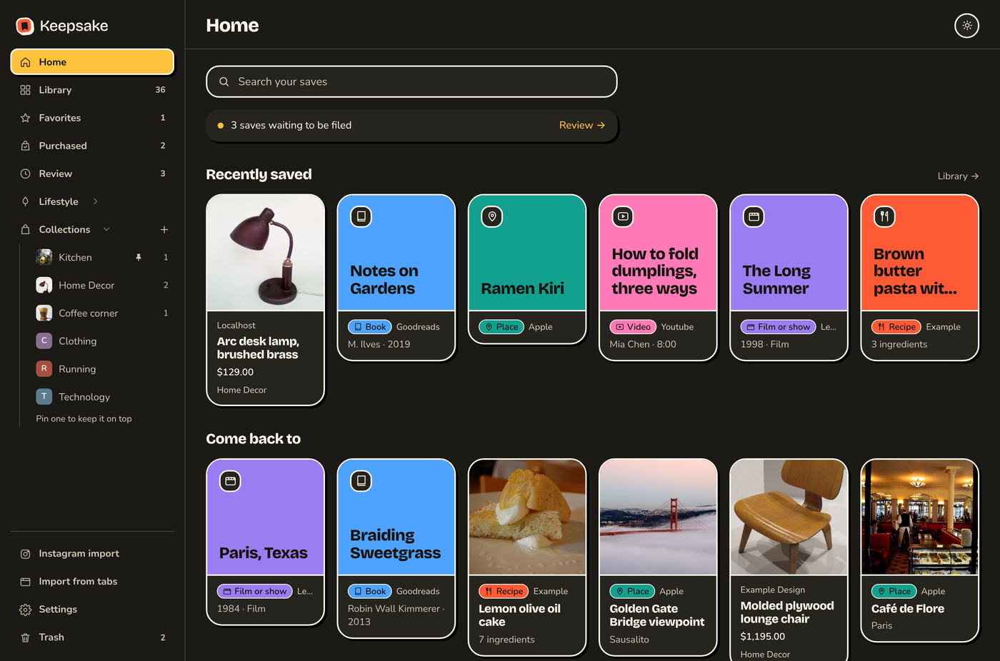 |
|  | 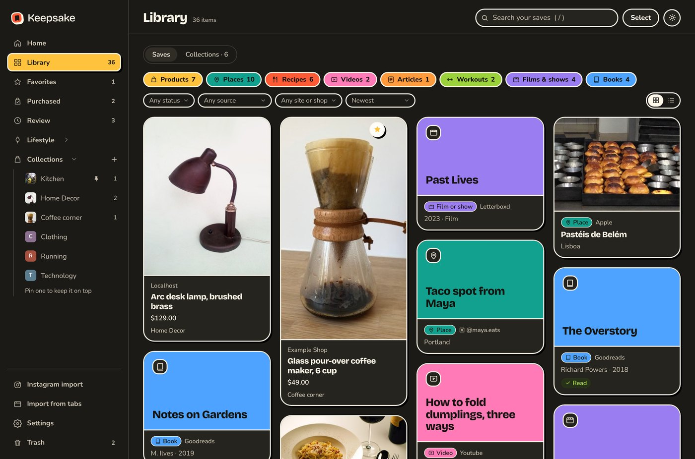 |
|  | 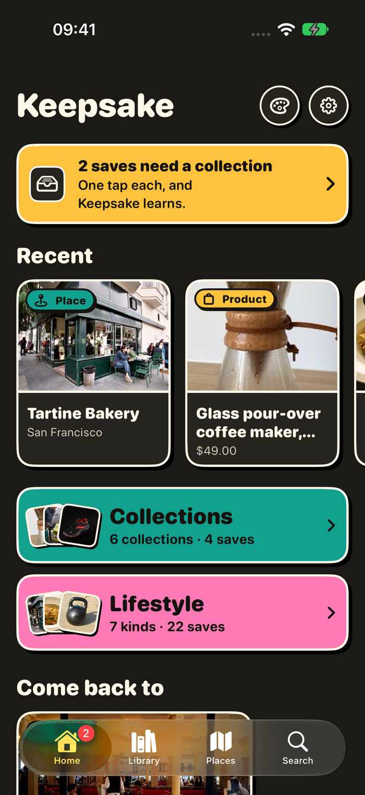 |
|  | 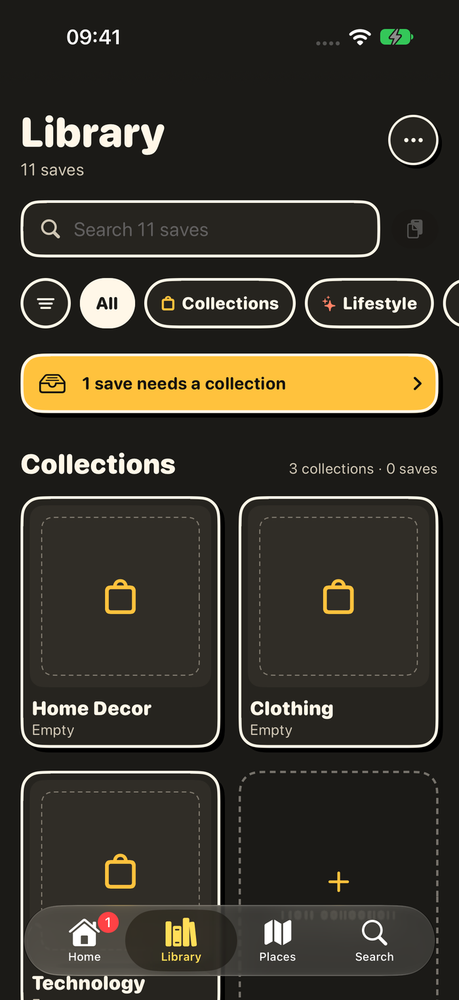 |
|  | 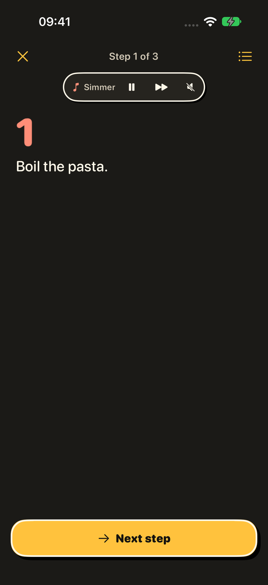 |
|  | 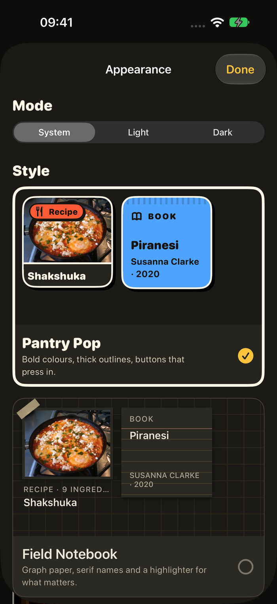 |
|  | 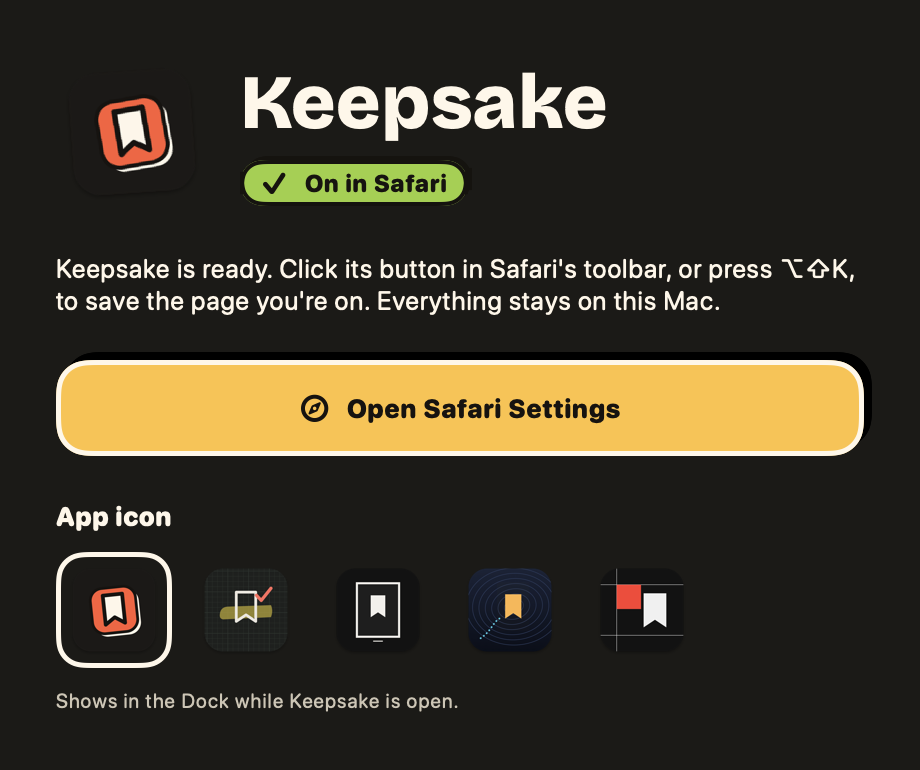 |

</details>

## What it does

- Works on any shop, without per-site integrations: reads JSON-LD / Open Graph / visible page data.
- Files each save into a collection automatically (Home Decor, Clothing, Technology, Kitchen, Camping & Outdoors, Weddings, Pets, …) and learns from your corrections. Unsure saves are left uncategorized and wait in **Review** instead of being guessed.
- Save anything anywhere: every "where does this go?" menu (popup, page card, Move to…, Review) lists the **Lifestyle** views and your **Collections**. Putting a save into a Lifestyle view makes it that kind and works out its details from what it holds (a place's name from the post's location tag or a "📍" line, a recipe's ingredients, a workout's exercises). With **Lookups** on (Settings, each off by default) Patchwork fills in the rest from free public sources: a place's address and pin from OpenStreetMap, a film's details from Wikidata, a book's from Open Library. With Optional AI on, your provider fills in what a post doesn't say. **Places** has a **Map** (OpenStreetMap, drawn on your device).
- Keeps shopping and life apart. **Collections** are for shopping: products sorted into collections, with Purchased. **Lifestyle** holds the rest, each kind in its own view: recipes, workouts, places, videos, articles, films and books; they never go into a collection. Products, plus **recipes** (ingredients, steps, servings and time read from the recipe page's structured data or from "Ingredients / Method" in a caption, all on your device), **workouts** (exercises with sets, reps or time and rest, read from a caption or a workout page's lists), **places** (restaurants, cafés and places to visit: address, pin, cuisine, price range and opening hours from the page's structured data, the name and pin from a Google Maps or Apple Maps link, the address on a business's own site or a venue listing, or a business's Instagram profile or Facebook page; a lookup is never used when the name matches places in different spots), **videos** (length, channel and date from YouTube, Vimeo and other video pages) and **articles** (author, site, date and reading time, counted from the article's own text on your device). **Films and shows** (year, director or creator, runtime or seasons, genre) and **books** (author, year, pages) are read from pages like Letterboxd, IMDb and Goodreads (a title's page on a known film or book site is always one, like YouTube for videos), and kept as simple lists to scroll: what's still to watch or read first, with a tick to move it to Watched or Read. A book with a price on a shop page stays a product. Anything from YouTube is saved as a video. Videos and articles open into a short view with Watch or Read. Videos, articles and links get **tags** guessed on your device from the title, channel and description (like "AI", "Video games" or "Shoes"); filter a view by tag, and change the tags in Edit details. The Lifestyle views sit together under **Lifestyle** in the menu; Collections fold too, keeping pinned ones in view. The **Library** (everything you've saved) has a filter bar (kind, status, source, site, sort), a grid or list layout, and a search that ranks titles first and fixes a typo (press / to search). Home shows what's waiting in Review, recent saves, and *Come back to*: saves you haven't opened in six weeks; nothing is embedded or played inside Patchwork. Places are listed by state (or country), then city, each with **Open in Maps**; a place with no name of its own or no state waits in **Places review** (next to List and Map), where *Fix with AI* (or *Read again*, on your device) names it and says where it is (Apple Maps or Google Maps; the link is built from what you saved, nothing is looked up). Recipes open straight into a recipe view with a checklist, steps and "Cooked"; you can edit them, and only if you ask with Optional AI on, get a labelled AI draft for a dish with no written recipe. Workouts open into a workout view where you can make a goal ("3× a week for 4 weeks" or "reach 3×12 push-ups"), check in with one tap and see your weeks fill in; with Optional AI on you can ask for a week-by-week progression, which you preview before accepting. Goals and check-ins stay on your device and are included in exports.
- Optional on-page save buttons for product grids, off until you turn them on, and only on sites you grant.
- Import your own **Instagram Saved collections**, then **read each post's page** for the real caption, creator, links and creator-tagged products (name, price, shop URL). No login, no credentials, just your existing session.
- Calm dashboard: a Home page with search, your latest saves and your top collections; a masonry grid with search, sort, filters, favorites, purchased, bulk actions; collection tiles that scale to hundreds of collections; five styles, each in light and dark.
- **No account. No server. No telemetry.** Everything lives on your device: in the browser profile (IndexedDB for your saves, `chrome.storage.local` for settings), or in the app on iPhone and iPad. Deleted saves wait 30 days in the Trash. Export/import as JSON. Delete everything in one click.
- Optional, opt-in, bring-your-own-key AI to help identify products in Instagram saves, with a preview of exactly what leaves the browser.
- On iPhone and iPad: save from any app's Share sheet, cook a recipe step by step with optional music, add Home Screen widgets, and pick from four styles with matching app icons.

The browser extension is Manifest V3, plain HTML/CSS/JS, no build step, no dependencies at runtime.

## Contents

1. [Install](#install)
2. [Dark mode](#dark-mode)
3. [Pin the icon and learn the shortcut](#pin-the-icon-and-learn-the-shortcut)
4. [Saving from the toolbar](#saving-from-the-toolbar)
5. [On-page save buttons (optional)](#on-page-save-buttons-optional)
6. [Right-click save](#right-click-save)
7. [How categorization works and how to train it](#how-categorization-works-and-how-to-train-it)
8. [The dashboard](#the-dashboard)
9. [Instagram Saved-collection import](#instagram-saved-collection-import)
10. [Optional AI](#optional-ai)
11. [Privacy, export, import, erase](#privacy-export-import-erase)
12. [Permissions explained](#permissions-explained)
13. [Limitations](#limitations)
14. [Development and tests](#development-and-tests)
15. [Releasing to the Chrome Web Store](#releasing-to-the-chrome-web-store)
16. [Project layout](#project-layout)

## Install

This README describes Patchwork 2.1.0. Pick the platform you use.

### Chrome, Edge, Brave and other Chromium browsers

Patchwork is published to the Chrome Web Store by the release workflow (see [Releasing to the Chrome Web Store](#releasing-to-the-chrome-web-store)). To run it straight from this repository instead:

1. Clone this repository (or download it as a zip and unzip it). You need the `keepsake/` folder, the one that contains `manifest.json`.
2. Open Chrome and go to `chrome://extensions`.
3. Turn on **Developer mode** (top-right toggle).
4. Click **Load unpacked** and pick the `keepsake` folder.
5. Patchwork installs, opens a short welcome page and creates the default collections. Nothing runs on any website yet.

Requires Chrome 121 or newer. Edge, Brave and other Chromium browsers use the same steps on their own extensions page. To update after editing files, click the reload icon on the Patchwork card at `chrome://extensions`.

### Safari on the Mac

The Safari version is the same extension inside a small Mac app (`safari/Keepsake/`). You need macOS 14 or newer, Xcode and Node 20+.

1. Open `safari/Keepsake/Keepsake.xcodeproj` in Xcode.
2. Pick the **Keepsake** scheme and your Mac, set your own team under *Signing & Capabilities* if Xcode asks, then **Run**. Each build runs `node safari/build.mjs` first, which copies `keepsake/` into `safari/dist/` as a Safari-ready build.
3. The Patchwork app opens. Click **Open Safari Settings** and tick **Patchwork** under *Extensions*. If Safari doesn't list it, turn on *Allow unsigned extensions* in Safari's developer settings and try again.
4. Click Patchwork's toolbar button, or press ⌥⇧K, to save the page you're on.

### iPhone and iPad

The app, its Share Extension and its widgets live in `ios/` (iOS 27 or newer). It isn't on the App Store yet, so you build it with Xcode:

1. Open `ios/Keepsake.xcodeproj` in Xcode.
2. Pick the **Keepsake** scheme and a simulator or your own device. On a device, set your own team under *Signing & Capabilities* (the App Group needs one).
3. **Run**. To save from Safari, Instagram or any app, tap Share and pick **Patchwork**.

From the command line:

```bash
xcodebuild -project ios/Keepsake.xcodeproj -scheme Keepsake -destination 'platform=iOS Simulator,name=iPhone 17' build
```

See [ios/README.md](ios/README.md) for the Swift package, tests and the shared core bundle.

## Dark mode

Patchwork follows your system's light or dark setting everywhere, and you can pin it to one.

- **Chrome and Safari extension:** Dashboard → **Settings → Appearance** has *System*, *Light* and *Dark*; the sun button at the top of the dashboard cycles through them. The choice applies to the dashboard, the popup and the save card shown on pages. The toolbar icon swaps to its dark version when the browser is dark.
- **iPhone and iPad:** Settings → **Appearance → Mode** has *System*, *Light* and *Dark*. The app icon has light, dark and tinted versions that follow the Home Screen.
- **Mac app:** follows the Mac's appearance.

Every style has a light and a dark version: Pantry Pop (the default), Field Notebook, Night Atlas and Swiss Index, plus Gallery in the browser extension. Pick one under Appearance, along with a matching toolbar or app icon.

## Pin the icon and learn the shortcut

Click the puzzle-piece icon in Chrome's toolbar and press the pin next to **Patchwork** so it is always one click away.

- **Alt+Shift+K** opens the Patchwork popup for the current page. Change it at `chrome://extensions/shortcuts`.
- **Alt+Shift+S** saves the product card you are hovering or focusing when on-page buttons are enabled.
- In the dashboard, **/** focuses search, **Esc** leaves select mode or closes dialogs, **Alt+↑ / Alt+↓** on a collection in the sidebar moves it.

## Saving from the toolbar

Open any page and click the Patchwork icon (or press Alt+Shift+K). The toolbar icon never saves on its own: the popup opens with **Open dashboard** at the top and the page's picture and title, then asks **Where does it live?**

1. Patchwork reads the page (a skeleton shows while it does) and says what it thinks ("Patchwork thinks **Home Decor**", or "Patchwork isn't sure yet").
2. Pick **Collections** (things to buy) or **Lifestyle** (recipes, places and more), then the collection or view. You can name a new collection right there. Or pick **Not sure? Put it in Review** and Patchwork suggests a home later.
3. Rename the title if you like, add a note, then **Save**.
4. The popup confirms with *Saved to …*, **Undo** and a button that opens where it landed (its collection, its Lifestyle view, or Review). When you picked something other than Patchwork's guess, "Use this choice for similar items" teaches the categorizer strongly.

If the page is already saved (tracking parameters ignored), Patchwork says so and offers **Update the saved one** or **Save another copy**. On pages Patchwork cannot read (browser pages, the Web Store, local files) it says so and offers the dashboard instead. On pages with no product data it still lets you save the page.

## On-page save buttons (optional)

Dashboard → **Settings → On-page save buttons**. Three modes:

| Mode | What Chrome asks | What runs |
| --- | --- | --- |
| **Off (default)** | nothing | nothing; the toolbar, shortcut and right-click menu still work everywhere |
| **Only on sites I choose** | permission for each site you add | the button script on those sites only |
| **On all sites** | "read and change data on all sites" | the button script on every site; Patchwork still only reads a card when you hover it |

When enabled, a small **Save** button appears next to product cards on listing pages and next to the main image on product pages. It lives in a closed Shadow DOM, is positioned over the page (never inserted into its layout), avoids logos, avatars, banners, navigation and ads, works with keyboard focus (Tab to a card, Alt+Shift+S) and respects `prefers-reduced-motion`.

- Saving from a card reads **only that card's** title, price, link and image and saves it straight away, following the same rule as the toolbar icon: at **75%** confidence or more it's filed into that collection; below that it goes to Review with the best guess suggested. Either way the toast says where it went and has a **Move to** menu, **Undo** and **Edit**. The right-click *Save to Patchwork* item works the same way. With Optional AI on, the AI picks the collection instead.
- Options: button size (small/medium/large) and position within the card. The site list shows only for *Only on sites I choose*; *Hidden on these sites* shows for *On all sites* (and for *Only on sites I choose* only while it still lists a site).
- Hide the button on specific sites (e.g. news sites) without revoking access, or **Revoke all site access** in one click. Switching away from "all sites" gives the broad permission back to Chrome automatically.

## Right-click save

Right-click a page, product image, link or selected text → **Save to Patchwork**. On listing pages Patchwork reads the card around the clicked image or link (title, price, link) rather than the whole page. A toast confirms with Undo/Edit.

## How categorization works and how to train it

Categorization runs **entirely locally** (`src/shared/categorizer.js`, deterministic, no network). For each save it scores every collection from:

- the product's title, description, structured category, breadcrumbs, image alt text, card text and, for Instagram, the Saved-collection name and caption;
- the **store's own product type and tags** when the page publishes them (Shopify's embedded product data, WooCommerce `product_cat-`/`product_tag-` classes). The type counts as much as the title; tags only back up a collection the product already matches elsewhere, because stores use them for merchandising ("Holiday Gift Guide");
- each collection's built-in vocabulary (strong keywords such as *tent*, *dutch oven*, *headphones* and softer ones such as *ceramic*, *wireless*), the collection's name and aliases, and **your own keywords** (a collection's page → *Keywords*: "for mum, birthday" on Gifts). Your keywords outweigh the built-in vocabulary, and a match makes Patchwork at least 85% sure. The more specific keyword wins: "coffee cup" on Kitchen beats "coffee" on Food for a coffee cup. If the same keyword is on two collections, matching items go to Review, and adding a keyword another collection already has asks whether to move it;
- **what it learned** from your corrections: every time you move an item, the salient words of its title get a small weight toward the new collection; "Use this choice for similar items" gives a strong weight. Retailers you file consistently also count.

Keywords match their plurals ("hoodie" → "hoodies", "battery" → "batteries"). Longer phrases beat shorter ones ("camp chair" beats "chair"). Usage phrases in descriptions ("at home", "on the job site", "on the go") are ignored, since they say how something is used rather than what it is. Collection names and aliases ("Home", "Body", "Gear") only count when they appear in the title, product type, category, tags or breadcrumbs (not in descriptions), and site-navigation crumbs like "Home" or "Shop all" are ignored. A confidence score compares the winner with the runner-up; a runner-up that only matched description words counts for much less than one that also matched the title, product type, category or breadcrumbs. Below the **threshold** (default 0.6, adjustable) the item is left uncategorized with a suggestion instead of a guess. The **Review** queue shows those, with one-click "Move to …" buttons that teach the categorizer.

Other knobs (Settings → Categorization): auto-create missing default collections (e.g. re-create *Tools* when a drill shows up), and a view of the strongest learned terms and retailer habits with a one-click clear. Similar collection names are never duplicated ("Lamps" and "lamp" are the same collection; "Home Décor" matches "Home Decor"); merging collections carries names over as aliases.

Patchwork starts with three collections (Home Decor, Clothing and Technology) and creates the rest of its default taxonomy (Camping & Outdoors, Kitchen, Van Build, Personal Care, Books & Media, Gifts, Travel, Tools, Weddings, Baby & Kids, Pets, Fitness & Wellness, Garden & Outdoor Living, Art & Crafts, Office & Stationery, Automotive, Jewelry & Watches, Music & Instruments, Party & Events) on demand, the first time something actually matches one. There is no separate Inbox collection: anything Patchwork can't confidently place is simply left uncategorized and shows up in **Review**. Rename, merge or delete any collection. Creating a collection whose name is close to an existing one (for example "Food" when Kitchen already covers food) asks which you meant instead of quietly using the existing one.

## The dashboard

Open it from the popup or from the extension's Options; it opens on **Home**, and the Patchwork name in the top-left corner always goes back there. Routes:

`#home` · `#all` · `#favorites` · `#purchased` · `#review` · `#collections` · `#c/<collection-id>` · `#item/<item-id>` (opens the item) · `#import` · `#settings` · `#ai` · `#ailog` · `#privacy` · `#welcome`

- **Home**: a search box (typing jumps to the Library with the search filled in), a "N saves waiting to be filed" line that appears only when Review has something, one row of your most recent saves, and five collection tiles: pinned collections first (up to five), then the ones you saved into most recently.
- **Menu**: Home, Library (every save), Favorites, Review (only while something is waiting to be filed) and Lifestyle; Purchased (everything marked purchased, which leaves the Library, Favorites and its collection until un-marked), then Collections (your collections; the chevron folds it, keeping pinned ones). The Library has two tabs: Saves and Collections (every collection). Trash is the last item, under Settings; Privacy is a section in Settings.
- **Masonry grid** of cards with image (or a text placeholder when there is none), title, price, retailer or Instagram creator, note, favorite star, source badge and "Needs sorting" label. Clicking a card opens a lightweight **Quick view** (image, title, price, a link to the original page); "Edit details" from there or from a card's **⋯** menu opens the full editor.
- **Search** across titles, retailers, notes, descriptions, prices, captions and creators; **sort** newest/oldest/price and **filter** by retailer or source from the compact bar above the grid; empty states for every view.
- **Item details**: the **exact link** the item was saved from, shown in full as a selectable field with **Copy** and **Visit page** (**Open post** for Instagram), and editable, so you can point an item at the right product page if the extractor grabbed a listing or a redirect. Changing the link updates the host, refreshes an auto-derived retailer name, re-keys duplicate detection, and refuses a link another item already has. Alongside it: edit title/price/note, choose a cover from the candidates, move collection (optionally "use for similar"), favorite / purchased / archived, delete (moves to the **Trash**, with Undo).
- **Select** mode for bulk move, favorite, delete (to Trash) and (when AI is on) *Find products*.
- **Trash** (`#trash`): deleted saves stay 30 days, with Restore (back to their collection, or Review if it's gone), Delete forever and Empty Trash.
- **Collections**: the sidebar lists every pinned collection, then the ones you saved into most recently, up to eight; the collection you have open is always listed. **All collections** opens every collection as a cover tile (a collage of its latest images), pinned first, with a name/keyword search and sorting by recently saved to, A–Z or most saves. Pin a collection from its tile, its page, or the sidebar (drag or Alt+↑/↓ to reorder pinned ones). Rename by editing the name on the collection's page; keywords, description and cover (newest image or your own URL) under *Keywords*; merge by selecting items and ticking *Merge* in **Move to…**; delete (items become uncategorized, waiting in Review, unless you choose otherwise).
- **Style and theme**: five styles (Pantry Pop, the default; Field Notebook; Gallery; Night Atlas; Swiss Index), each with system / light / dark (Settings → Appearance; the sun button in the header cycles the theme), and a matching toolbar icon. The style applies to the popup, the dashboard and the save card shown on pages. See [Dark mode](#dark-mode).
- **Load sample data** from the welcome page or the empty state to see the layout; delete it any time.

## Instagram Saved-collection import

Patchwork never asks for Instagram credentials and never calls Instagram's API. It reads the page you already have open.

1. In Chrome, log in to Instagram normally and open **one of your Saved collections** (`instagram.com/<you>/saved/<collection>/…`). To bring in everything at once, open your *Saved* page (`instagram.com/<you>/saved/`) instead: the popup offers **Import all collections**, opens each collection in turn, then "All posts" for anything in no collection, and by default makes each Instagram collection a group with the same name.
2. Click the Patchwork icon. The popup recognises the collection and shows **Import this collection**.
3. Click it. Patchwork injects a small reader into **that tab only**, scrolls the collection to load more posts, and shows live progress (*24 posts found…*) with a **Stop** button. It stops automatically at the end of the collection, after a quiet period (default 6 s with nothing new), at the **safety limit** (default 300 posts), or when you press Stop.
4. Click **Review** to open the dashboard. It shows how many posts were found and how many are already in Patchwork (those are skipped), and one button: **Import N posts**.
5. **Import.** The first time, Patchwork asks for `instagram.com` access (revocable under Settings → Instagram) so it can read each post's own page with your existing session, one at a time with a short pause: the **full caption** (the title), the **creator**, the post date, its **location tag** (name, street, city, pin), **hashtags**, **links in the caption** and **products the creator tagged**. A progress dialog shows how far it's got; *Keep working in the background* hides it (the bar under the header carries on, with Show and Stop), and *Stop and import* files what's been read so far. Without access, posts are imported with what the grid showed.
6. Patchwork files each post: an Instagram collection named for a Lifestyle view goes there ("Restaurants", "NYC eats" → Places; "Recipes"; "Workouts"); otherwise a caption with a recipe, a workout or a "📍" place goes to that view, products go to the best-fitting collection (a new one when the collection name calls for it), and anything it isn't sure about waits in **Review**. A place is named from its caption's "📍" line or its location tag, with the tag's street, city and pin; Lookups and Optional AI (if on) fill in the rest.
7. **Where everything went**: a summary lists each Lifestyle view and collection with how many posts went there, how many wait in Review (with *Open Review*, and *Sort Review with AI* when AI is on), and how many were skipped or couldn't be read; *Done* takes you Home. Every post keeps the **original post URL**, creator, caption, hashtags, caption links and tagged products. In the item detail view, each tagged product or caption link has **Open** and **Save as product**, which creates a real product item linked back to the post it came from. Patchwork remembers which posts it imported so re-scanning never duplicates them.

If a creator didn't tag anything and put no link in the caption (the "link in bio" case), there is genuinely no product data on the post. That is what the optional AI below is for.

Thumbnails: Instagram image links expire, so Patchwork stores a small local copy (JPEG, ≤ 320 px) by default. Turn this off in Settings → Instagram to store only the link. Settings also expose the safety limit and idle timeout.

Limits and honesty: this depends on Instagram's page markup. All selectors live in one file (`src/instagram/adapter.js`) so they can be updated when Instagram changes. Reels and posts are imported; captions come from what Instagram exposes in the grid (alt text), so they can be short. Patchwork does **not** identify products in posts unless you enable the optional AI feature below.

## Optional AI

Off by default, and it needs **your own API key**. It's one switch (**Use AI**): when it's on, the AI tidies each new save, and *Fix with AI* and *Find products* are available. There are no per-feature toggles.

- Dashboard → **Optional AI**. Choose Anthropic (the default for new installs), OpenAI or a custom OpenAI-compatible endpoint and paste your key. With Anthropic you pick a Claude model from a list and an effort level (Medium by default); other providers take a model name. Enabling asks Chrome for permission to contact **only the provider's address**; disabling revokes it.
- Your key is stored in `chrome.storage.local` under a separate `keepsake_secrets` key that is **never included in exports**. *Remove key* wipes it.
- On an Instagram card (or in bulk via Select → *Find products (AI)*) click **Find this product online**. Before anything is sent you see the exact payload: the stored thumbnail (image) and the caption / creator / collection name (text). Nothing else: no cookies, no account data, no browsing history.
- With **web search** ticked (OpenAI and Anthropic only; custom endpoints have no search tool), the provider runs up to three web searches per post and returns real listings: product name, brand, retailer, price and a link. Each link is checked against the URLs its search actually returned; anything the model made up is **dropped**, and the candidate is shown without a link rather than with a fake one. Every result gets an **Open** and a **Save as product** button, so a found listing becomes a normal Patchwork item with price and URL, linked back to the post.
- *Identify only* skips the search and just names the likely item, with category, brand and 2–4 **Search the web** phrases you can click yourself.
- Everything here is labelled as a guess: the model can identify the wrong item, and prices go stale. Check the listing before buying.
- **After a save**: the on-page button and the right-click menu save straight away using the local categorizer (at 75% or more it's filed, otherwise it waits in Review); the toolbar popup saves where you picked. The save is stored **before** anything is sent; then the AI tidies the title and may re-file it if it's confident (at or above your threshold), unless you already edited the title or moved the item. For something to buy, it reads the picture as well as the words, searches the web for the product's page, and Patchwork reads that page's product data; the card shows the shop's facts first and the AI's summary labelled *AI summary*. Those changes go to the AI change log with Undo, and the original title is kept. If the provider is slow or offline the save is unaffected. The popup says *Finishing details…* while the AI works.
- **Check with AI** (Review → *Fix all with AI*, or *Check with AI* at the top of the Library or a collection; Lifestyle views have their own, which fills in what each save is missing, with a progress bar and Stop): reads each item's live product page (optional, without cookies), then tidies titles, updates prices (the model may only choose a number that appears on the page or in the saved data), replaces missing/broken images, and files items into collections. From Review, an item is filed when the AI's confidence meets your threshold; elsewhere an item is only moved at ≥ 85% and never if you filed it yourself. Fixes apply immediately, and every change goes to the **AI change log** (`#ailog`) with per-item and per-run Undo. Dead links, out-of-stock items and unfixable broken images are listed at the end of a run.

Local vs cloud in one sentence: everything in Patchwork (saving, extraction, categorization, dashboard, Instagram import) runs on your machine with no network; the only network calls Patchwork makes are to the AI provider **you** configured (when Optional AI is on: each save, and runs you start) and, for a *Fix with AI* run with live-page reading ticked, to your saved items' own product pages (without cookies).

## Privacy, export, import, erase

See [keepsake/PRIVACY.md](keepsake/PRIVACY.md) (browser extension), [ios/PRIVACY-iOS.md](ios/PRIVACY-iOS.md) (iPhone and iPad), the in-extension **Privacy** page, and the privacy policy at [rarecreatures.app/apps/keepsake/privacy](https://rarecreatures.app/apps/keepsake/privacy/). In short:

- **Export** (Settings → Data): downloads `keepsake-export-<date>.json` with collections, items, learned preferences, settings and import history. Never the API key.
- **Import**: pick a JSON export. Patchwork validates it (format, schema version, every field sanitized, URLs must be http(s)) and either **merges** (collections dedupe by name, items by URL; duplicates are reported) or **replaces** everything after a typed confirmation.
- **Delete all local data**: typed confirmation, then everything is wiped (including any AI key) and the defaults are recreated. Learned preferences (word and retailer habits, corrections) can be cleared separately; your collections' keywords are kept.
- Settings shows item/collection counts and how much local storage Patchwork uses. Items are capped at 20,000 and collections at 500 to keep the dashboard responsive.

## Permissions explained

| Permission | When | Why |
| --- | --- | --- |
| `storage` | install | Keep settings and the optional AI key in `chrome.storage.local`. |
| `unlimitedStorage` | install | Store your library in IndexedDB without Chrome's 10 MB default cap. Stays on your device. |
| `activeTab` + `scripting` | install | When you click the icon, press the shortcut or use the context menu, read *that* page's title/price/images at that moment and show the confirmation toast. Nothing runs on pages otherwise. |
| `contextMenus` | install | The "Save to Patchwork" right-click item. |
| Site access (`optional_host_permissions`: `*://*/*`) | **only if you enable on-page buttons, use *Import from tabs*, or start a *Fix with AI* run with live-page reading** | Run the hover-button script on the sites you granted (per site or all); read saved items' product pages during *Fix with AI*. Revocable in Settings or at `chrome://extensions`. |
| `https://www.instagram.com/*` | **only if you use "Read post details"** | Read each imported post's own page (caption, creator, links, tagged products) with your existing session. Revocable under Settings → Instagram. |
| Provider origin (e.g. `https://api.openai.com/*`) | **only if you turn AI on** | Let the dashboard and background worker call the API you configured. Given back when you turn AI off. |
| `https://nominatim.openstreetmap.org/*` + `https://tiles.openfreemap.org/*`, `https://www.wikidata.org/*`, `https://openlibrary.org/*` | **only if you turn on that Lookup** (Settings → Lookups) | Find a place's address and pin and draw the Places map; a film's or a book's details. Given back when you turn the lookup off. |

No `tabs`, `history`, `cookies`, `webRequest`, `alarms` or `identity`. The background worker has no timers; its only network access is the call to your AI provider after a save, when Optional AI is on, and the Lookups you turned on.

## Limitations

- **Extraction is heuristic.** Sites with JSON-LD/Open Graph data are read accurately; heavily scripted stores, infinite-scroll grids that render prices lazily, or pages that hide products behind "Quick view" may yield a title without a price or the wrong image. Everything is editable before and after saving.
- **Prices are snapshots.** Patchwork does not re-check prices, stock or availability, and does not know about variants (size/color) beyond what is in the page.
- **On-page buttons can be wrong** on unusual layouts (very large "cards", galleries). The detector errs on the side of silence; use the toolbar or right-click on those pages.
- **Instagram** markup changes often; the importer and post reader may need adapter updates. "Read post details" opens one post page at a time with a pause between them to stay polite; it is roughly 2–3 seconds per post (about four minutes for 90 posts) and Instagram can still rate-limit or show a login page, in which case Patchwork falls back to reading the post in a short-lived background tab and reports the ones it couldn't get. Posts where the creator tagged nothing and linked nothing simply have no product data to find.
- **AI suggestions are guesses.** They are labelled as such, and cost money on your own account.
- **No sync.** Data lives in one browser profile. Use export/import to move it.
- Tested with Node + jsdom (`npm test` at the repository root) and reviewed by hand; the automated suite does not drive a real Chrome, so pixel-level behaviour on real sites should be spot-checked after install.

## Development and tests

No build step for the extension. The test tooling lives at the **repository root** (`package.json`, `tests/`), outside `keepsake/`, so it never ends up in the Chrome Web Store package. Requirements: Node 20+.

```bash
npm install          # jsdom (dev only)
npm test             # every suite
npm run check        # static checks on keepsake/ only
```

What the suite covers (`tests/`):

- `check-extension.test.mjs`: valid MV3 manifest, every referenced file exists, least-privilege permissions, strict CSP, all JS parses, no HTML-string/eval APIs (one reviewed constant SVG allowed), no inline or remote scripts and styles in extension pages, dev tooling kept out of `keepsake/`.
- `shared.test.mjs`: URL normalization and duplicate keys, price parsing, sanitizers, the categorizer's golden set (camping, tech, kitchen, clothing, home, tools), Review on low confidence, user keywords, Instagram collection matches, learning from corrections and forgetting deleted collections.
- `storage.test.mjs`: init and migrations (v1 rules → v2 keywords, old AI switches), CRUD, duplicates, collections (dedupe, merge, delete, reorder), export without the API key or AI log, import merge/replace, hostile-import sanitizing and limits, Instagram import history, AI log cap, erase, sample data.
- `extract-instagram-ai.test.mjs`: JSON-LD, Open Graph, sparse pages and hints in jsdom; Instagram post parsing (caption, links, hashtags, login wall, titles); the optional-AI boundary with a fake `fetch` (invented prices, collections and links are dropped; remote thumbnails never forwarded; errors surfaced).
- `background.test.mjs`: the real service worker with a fake `chrome.*`: install, save, duplicate and copy, Review for unsure saves, manual choice and learning, undo, patch allow-list, privileged messages refused from pages, context-menu save, and today's AI-on save path.
- `dashboard.test.mjs`: boots the real dashboard in jsdom and renders every route, empty state, sample data and Review.

Tests marked `KNOWN ISSUE` / `KNOWN RISK` describe current behaviour that is scheduled to change (see `replica/keepsake-audit.md`); `todo` tests are known bugs. None of this drives a real Chrome: check behaviour on real sites after installing the unpacked extension.

## Releasing to the Chrome Web Store

Releases are automated with GitHub Actions (`.github/workflows/release.yml`):

1. Bump `version` in `keepsake/manifest.json`.
2. Commit, then tag the commit `vX.Y.Z` (matching the manifest version exactly) and push the tag:
   ```bash
   git tag v1.2.3
   git push origin v1.2.3
   ```
3. The workflow checks out the tag, verifies the tag matches `manifest.json`'s `version`, zips the extension (`manifest.json`, `background.js`, `icons/`, `src/`, docs excluded), uploads it to the existing Chrome Web Store listing via the Chrome Web Store Publish API, and publishes it. It also attaches the zip to a GitHub release for that tag.
4. Chrome reviews the update (usually within a few hours to a few days) before it rolls out to users; the workflow's "Publish item" step succeeds once the item is submitted for publishing, not once review finishes.

This requires a Google Cloud service account with Chrome Web Store access, stored as GitHub Secrets: `CHROME_SERVICE_ACCOUNT_KEY` (the JSON key) and `CHROME_PUBLISHER_ID`. The target listing (`icons/`, `icon128.png` as the store icon, single purpose, permission justifications from the table above, remote code: none, data usage: none collected, `PRIVACY.md` as the privacy policy text) is configured once in the [Chrome Web Store Developer Dashboard](https://chrome.google.com/webstore/devconsole) and does not need to change per release.

## Project layout

At the repository root:

```
keepsake/                    the browser extension (this is what ships to the Chrome Web Store)
safari/                      Safari for Mac: build.mjs makes safari/dist from keepsake/, Keepsake/ is the Xcode project
ios/                         the iPhone and iPad app, Share Extension, widgets and KeepsakeKit (see ios/README.md)
tests/                       Node test suites for the extension (npm test)
tools/                       icon rendering scripts
docs/screenshots/            the screenshots in this README
replica/                     design notes, release notes and audits
```

Inside `keepsake/`:

```
manifest.json                MV3 manifest
background.js                service worker: context menu, message hub, saving, content-script registration
icons/styles/                one toolbar icon per style (Pantry Pop is the default), each with a dark/ version for dark toolbars
src/shared/                  util, url, taxonomy, categorizer, storage (schema 3 + migrations), db (IndexedDB records), messages, base.css
src/extract/extract.js       page extractor (JSON-LD → OG/Twitter → microdata → visible heuristics)
src/content/                 toast.js (Shadow DOM toast), detector.js (card detection), floating.js (hover button)
src/instagram/               adapter.js (all Instagram selectors), scan.js (scroll + collect + report),
                             post.js (post-page parsing), post-page.js (in-tab reader), enrich.js (read details for a scan)
src/ai/provider.js           optional BYOK provider boundary
src/popup/                   toolbar popup
src/toolbar/                 sets the toolbar icon you picked, swapping to its dark version when the browser is dark
fonts/, vendor/               bundled fonts (OFL) and the map library for Places
src/dashboard/               dashboard page, ui primitives, settings/AI/privacy pages, Instagram importer
```

License: MIT. Patchwork is made by [Rare Creatures LLC](https://rarecreatures.app) · [hello@rarecreatures.app](mailto:hello@rarecreatures.app).
